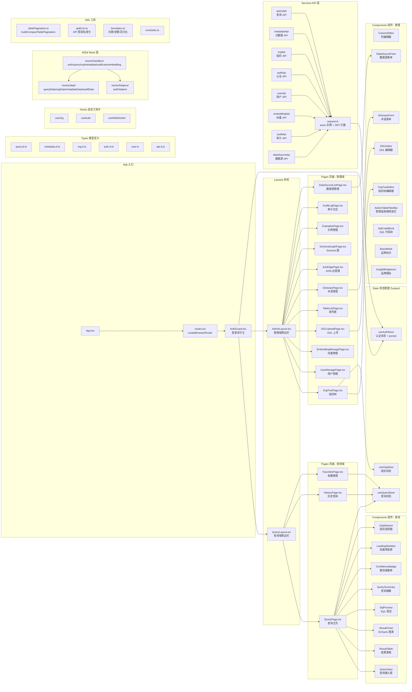
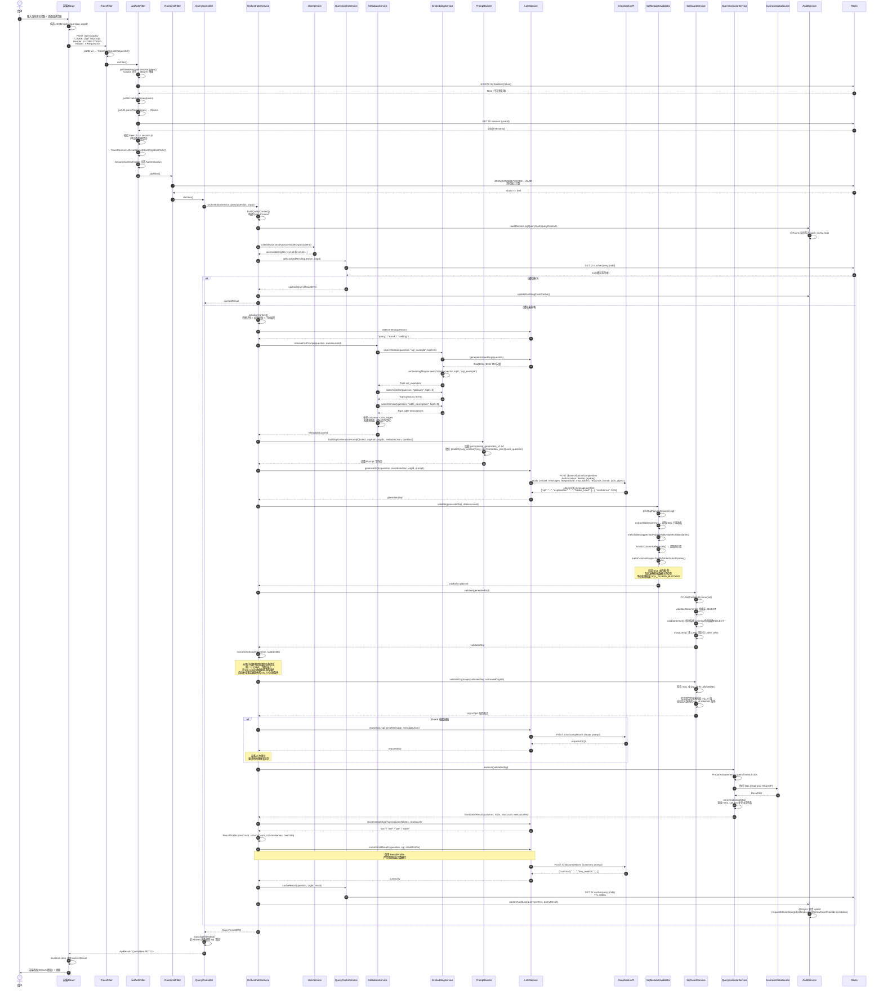
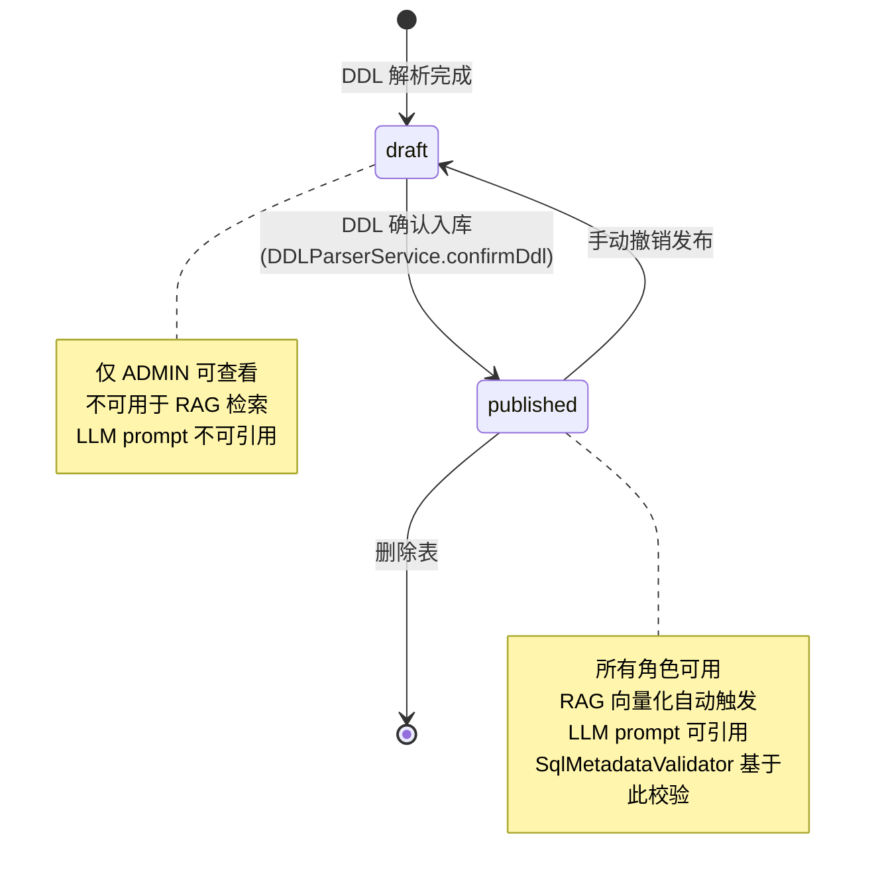
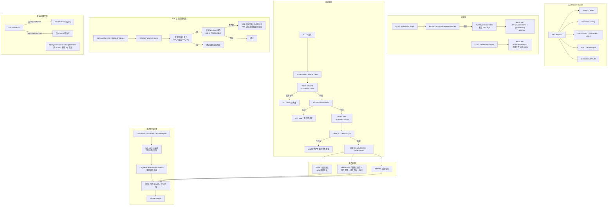
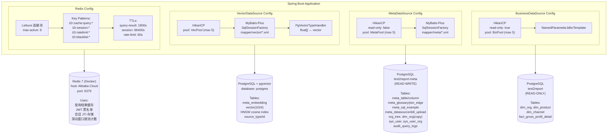

# Text2Report 系统架构文档

> 生成时间：2026-05-11 CST
> 基于代码版本：master 分支（commit: fc1fb50），M11 里程碑完成 + P0 安全修复已合并 + 元数据发布生命周期 + SQL 元数据校验 + RAG 相关性评分

---

## 目录 (TOC)

1. [项目概述](#1-项目概述)
2. [技术栈总览](#2-技术栈总览)
3. [系统整体架构](#3-系统整体架构)
4. [前端完整架构](#4-前端完整架构)
5. [后端完整架构](#5-后端完整架构)
6. [核心查询链路完整时序](#6-核心查询链路完整时序)
7. [RAG 向量检索架构](#7-rag-向量检索架构)
8. [元数据发布生命周期与 SQL 校验](#8-元数据发布生命周期与-sql-校验)
9. [权限架构](#9-权限架构)
10. [多数据源架构](#10-多数据源架构)
11. [安全防护体系](#11-安全防护体系)
12. [元数据库 Schema](#12-元数据库-schema)
13. [API 接口清单](#13-api-接口清单)
14. [Prompt 模板体系](#14-prompt-模板体系)
15. [反模式警示](#15-反模式警示)
16. [里程碑历史](#16-里程碑历史)
17. [技术债与待完成项](#17-技术债与待完成项)

---

## 1. 项目概述

### 1.1 项目定位

Text2Report 是一个**企业级自然语言转报表平台**（NL2SQL Enterprise Reporting Platform），其目标不是通用聊天机器人，而是将受控的业务问题转换为安全的 SQL，通过受监管的只读路径执行，并以图表、表格、摘要和可下载报表的形式呈现结果。

### 1.2 四条不可违反的核心原则

本仓库必须始终保留四条不变量：

1. **LLM sees metadata only — never real business data.**
   LLM 仅能看到元数据，严禁传入真实业务数据。
2. **All SQL execution must pass through `SqlGuardService` (JSqlParser AST validation). No exceptions.**
   所有 SQL 执行必须通过 `SqlGuardService` 的 JSqlParser AST 校验，无一例外。
3. **Only `SELECT` / `WITH...SELECT` is permitted in production. All write operations are forbidden.**
   生产环境仅允许 SELECT 和 WITH...SELECT 语句，所有写操作被禁止。
4. **Every request must be auditable (`audit_query_log`).**
   每个请求必须可审计，写入 `audit_query_logs` 表。

### 1.3 当前里程碑状态

- **当前里程碑**：M11 完成，准备进入 M12（多模型配置架构 + 元数据驱动组织范围升级）
- **代码状态**：代码完成，P0 安全修复已合并到 master，元数据发布生命周期、SQL 元数据校验、RAG 相关性评分已上线
- **测试状态**：后端 30 个测试文件（覆盖 controller/service/config/domain/mapper），前端 TypeScript 编译 0 error，生产构建成功
- **验收状态**：真实环境验收待执行（权限链路、RAG 检索、异步向量化、组织同步、端到端查询）
- **已知 P0 问题**：0 个（P0 修复已于 2026-05-03 合并）
- **已知 P1 问题**：8 个（部分已修复，持续收敛中）

---

## 2. 技术栈总览

| 层级 | 技术 | 版本/说明 |
|------|------|-----------|
| **前端框架** | React | 19 |
| **前端语言** | TypeScript | 6.0 (严格模式) |
| **UI 组件库** | Ant Design | 5.29.x |
| **构建工具** | Vite | 8.x |
| **状态管理** | Zustand | 5.x + persist 持久化 |
| **HTTP 客户端** | Axios | request.ts 封装 JWT 拦截 |
| **图表库** | ECharts | 通过 echarts-for-react |
| **Mock 服务** | MSW (Mock Service Worker) | 浏览器端拦截 |
| **后端运行时** | Java | 21 |
| **后端框架** | Spring Boot | 3.2.x |
| **ORM** | MyBatis-Plus | 3.5.x |
| **SQL 安全** | JSqlParser | 4.x（AST 校验，强制执行） |
| **认证框架** | Spring Security | + JWT (jjwt 0.12.x) |
| **密码加密** | BCrypt | Spring Security BCryptPasswordEncoder |
| **业务数据库** | PostgreSQL | text2report（只读，HikariCP read-only=true） |
| **元数据库** | PostgreSQL | text2report-meta（读写） |
| **向量数据库** | PostgreSQL + pgvector | meta_embedding 表，HNSW cosine 索引 |
| **缓存** | Redis | 7（Alibaba Cloud Docker 容器） |
| **LLM 服务** | DeepSeek API | deepseek-chat 模型，通过 LLMService 接口隔离 |
| **LLM 通信** | OkHttp | LLMAsyncExecutor 异步 HTTP |
| **Embedding 模型** | BGE-M3 | 本地 Ollama HTTP 推理服务，1024 维向量 |
| **Embedding 接入** | Spring AI Ollama | spring.ai.ollama 自动配置 |
| **向量存储** | pgvector | meta_embedding 表 1024 维 vector |

---

## 3. 系统整体架构

```mermaid
graph TD
    subgraph "用户层"
        U[用户/管理员]
    end

    subgraph "前端 React 18 + TypeScript + Ant Design 5"
        FE[React SPA]
        MSW[MSW Mock Server]
    end

    subgraph "网关与过滤器链"
        TF[TraceFilter<br/>建立 RequestId]
        JAF[JwtAuthFilter<br/>JWT 校验 + Redis 黑名单 + 会话 JTI]
        RLF[RateLimitFilter<br/>Redis Sorted Set 滑动窗口]
    end

    subgraph "Controller 层"
        QC[QueryController]
        MC[MetadataController]
        OC[OrgController]
        AC[AuthController]
        UC[UserController]
        EC[EmbeddingController]
        AUC[AuditController]
        DSC[DataSourceController]
        HC[HealthController]
    end

    subgraph "Service 编排层"
        OS[OrchestratorService]
        US[UserService<br/>组织权限裁剪]
        QCS[QueryCacheService<br/>Redis 缓存]
    end

    subgraph "LLM 服务层"
        LS[LLMService 接口]
        OAI[OpenAILLMService<br/>DeepSeek API]
        LLS[LocalLLMService<br/>预留 Qwen]
        LAE[LLMAsyncExecutor<br/>OkHttp @Async]
    end

    subgraph "元数据与 RAG 层"
        MS[MetadataService<br/>向量优先 + 关键词兜底]
        ES[EmbeddingService<br/>BGE-M3 向量化]
        BGE[本地 BGE-M3<br/>Ollama HTTP 推理]
        PB[PromptBuilder<br/>加载 /prompts 模板]
    end

    subgraph "SQL 安全层"
        SGS[SqlGuardService<br/>JSqlParser AST 校验]
    end

    subgraph "执行层"
        QES[QueryExecutorService<br/>PreparedStatement 只读执行]
    end

    subgraph "审计层"
        AS[AuditService<br/>@Async 异步写入]
    end

    subgraph "数据源"
        BDS[(businessDataSource<br/>text2report 只读)]
        MDS[(metaDataSource<br/>text2report-meta 读写)]
        VDS[(vectorDataSource<br/>meta_embedding pgvector)]
        REDIS[(Redis 7<br/>Cache/Session/RateLimit)]
    end

    subgraph "外部服务"
        DS[DeepSeek API<br/>deepseek-chat]
    end

    U --> FE
    FE --> MSW
    FE --> TF
    TF --> JAF
    JAF --> RLF
    RLF --> QC
    RLF --> MC
    RLF --> OC
    RLF --> AC
    RLF --> UC
    RLF --> EC
    RLF --> AUC
    RLF --> DSC
    RLF --> HC

    QC --> OS
    OS --> US
    OS --> QCS
    QCS --> REDIS
    OS --> MS
    MS --> ES
    ES --> BGE
    MS --> PB
    PB --> LS
    LS --> OAI
    OAI --> LAE
    LAE --> DS
    OS --> SGS
    SGS --> QES
    QES --> BDS
    MS --> MDS
    ES --> VDS
    OS --> AS
    AS --> MDS

    %% 安全约束虚线标注
    SGS -.- |"仅传 ResultProfile<br/>禁止传原始业务数据行"| LS
    SGS -.- |"仅允许 SELECT / WITH SELECT<br/>禁止 INSERT/UPDATE/DELETE/DROP"| QES
```

### 安全约束说明

图中虚线标注两个核心安全约束：
- **LLM 隔离边界**：`OrchestratorService → LLMService.summarizeResults(ResultProfile)` 仅传递 `ResultProfile`（包含 rowCount、columnNames、hasData），严禁传递原始业务数据行
- **SQL 语句白名单**：`SqlGuardService` 在 AST 层面仅放行 SELECT 和 WITH...SELECT，所有写操作（INSERT/UPDATE/DELETE/DROP/TRUNCATE/ALTER/MERGE/EXECUTE）在解析后立即拦截

---

## 4. 前端完整架构



### 4.1 路由结构

| 路径 | 页面组件 | 布局 | 权限 |
|------|---------|------|------|
| `/login` | LoginPage | 无 | 公开 |
| `/` | 重定向到 `/query` | — | — |
| `/query` | QueryPage | QueryLayout | 已认证 |
| `/query/history` | HistoryPage | QueryLayout | 已认证 |
| `/query/favorites` | FavoritesPage | QueryLayout | 已认证 |
| `/admin` | 重定向到 `/admin/org-tree` | — | MANAGER+ |
| `/admin/org-tree` | OrgTreePage | AdminLayout | MANAGER+ |
| `/admin/users` | UserManagePage | AdminLayout | MANAGER+ |
| `/admin/schema-graph` | SchemaGraphPage | AdminLayout | MANAGER+ |
| `/admin/audit` | AuditLogPage | AdminLayout | MANAGER+ |
| `/admin/ddl` | DDLUploadPage | AdminLayout | ADMIN |
| `/admin/tables` | TableListPage | AdminLayout | ADMIN |
| `/admin/glossary` | GlossaryPage | AdminLayout | ADMIN |
| `/admin/joins` | JoinEdgePage | AdminLayout | ADMIN |
| `/admin/examples` | ExamplesPage | AdminLayout | ADMIN |
| `/admin/datasources` | DataSourceListPage | AdminLayout | ADMIN |
| `/admin/embeddings` | EmbeddingManagePage | AdminLayout | ADMIN |

### 4.2 状态管理 (Zustand Stores)

| Store | 文件 | 持久化 | 核心状态 |
|-------|------|--------|---------|
| `useAuthStore` | `store/useAuthStore.ts` | persist (localStorage) | token, user, role, login/logout/refresh |
| `useOrgStore` | `store/useOrgStore.ts` | — | orgTree, selectedOrg, fetchOrgTree |
| `useQueryStore` | `store/useQueryStore.ts` | — | currentResult, history, loading, error |

### 4.3 API 服务层

| API 模块 | 文件 | 基路径 |
|---------|------|--------|
| `request.ts` | `services/request.ts` | axios 实例，withCredentials 发送 httpOnly cookie JWT，401 拦截跳转登录，API 错误标准化处理 |
| `queryApi` | `services/queryApi.ts` | `/api/v1/query` |
| `metadataApi` | `services/metadataApi.ts` | `/api/v1/metadata` |
| `orgApi` | `services/orgApi.ts` | `/api/v1/orgs` |
| `authApi` | `services/authApi.ts` | `/api/v1/auth` |
| `userApi` | `services/userApi.ts` | `/api/v1/users` |
| `embeddingApi` | `services/embeddingApi.ts` | `/api/v1/embeddings` |
| `auditApi` | `services/auditApi.ts` | `/api/v1/audit` |
| `dataSourceApi` | `services/dataSourceApi.ts` | `/api/v1/datasources` |

### 4.4 MSW Mock 处理器

| Handler 文件 | 覆盖接口 |
|-------------|---------|
| `mocks/handlers/authHandlers.ts` | `POST /api/v1/auth/login`, `POST /api/v1/auth/logout`, `GET /api/v1/auth/me`, `POST /api/v1/auth/refresh` |
| `mocks/handlers/queryHandlers.ts` | `POST /api/v1/query`, `GET /api/v1/query/history`, `GET/POST/DELETE /api/v1/query/:requestId/favorite`, `POST /api/v1/query/:requestId/feedback` |
| `mocks/handlers/orgHandlers.ts` | `GET /api/v1/orgs/tree`, `GET /api/v1/orgs/my-tree`, `GET /api/v1/orgs/:id/subtree-ids` |
| `mocks/handlers/metadataHandlers.ts` | 所有 `/api/v1/metadata/*` 接口 |
| `mocks/handlers/auditHandlers.ts` | `GET /api/v1/audit/logs`, `GET /api/v1/audit/stats` |
| `mocks/handlers/userHandlers.ts` | `GET/POST/PUT /api/v1/users`, `PUT /api/v1/users/:id/activate` |
| `mocks/handlers/embeddingHandlers.ts` | `POST /api/v1/embeddings/sync`, `POST /api/v1/embeddings/search`, `GET /api/v1/embeddings/stats` |

---

## 5. 后端完整架构

```mermaid
graph TD
    subgraph "Controller 层"
        QC2[QueryController<br/>@RestController<br/>/api/v1/query]
        MC2[MetadataController<br/>@RestController<br/>/api/v1/metadata]
        OC2[OrgController<br/>@RestController<br/>/api/v1/orgs]
        AC2[AuthController<br/>@RestController<br/>/api/v1/auth]
        UC2[UserController<br/>@RestController<br/>/api/v1/users]
        EC2[EmbeddingController<br/>@RestController<br/>/api/v1/embeddings]
        AUC2[AuditController<br/>@RestController<br/>/api/v1/audit]
        DSC2[DataSourceController<br/>@RestController<br/>/api/v1/datasources]
        HC2[HealthController<br/>@RestController<br/>/api/v1/health]
    end

    subgraph "Service 层 - 核心查询"
        OS2[OrchestratorService<br/>端到端查询编排]
        SGS2[SqlGuardService<br/>JSqlParser AST 校验]
        QES2[QueryExecutorService<br/>PreparedStatement 执行]
        QCS2[QueryCacheService<br/>Redis 查询缓存]
        AS2[AuditService<br/>@Async 异步审计]
        PB2[PromptBuilder<br/>模板填充]
    end

    subgraph "Service 层 - LLM"
        LS2[LLMService 接口<br/>5 个方法]
        OAI2[OpenAILLMService<br/>DeepSeek 实现]
        LLS2[LocalLLMService<br/>Qwen 预留]
        LAE2[LLMAsyncExecutor<br/>OkHttp 线程池]
        BGE2[BgeEmbeddingProvider<br/>Spring AI Ollama]
    end

    subgraph "Service 层 - 元数据与 RAG"
        MS2[MetadataService<br/>向量优先混合检索]
        ES2[EmbeddingService<br/>向量化与同步]
    end

    subgraph "Service 层 - SQL 元数据校验"
        SMV[SqlMetadataValidator<br/>生成 SQL 元数据校验]
        TRS[TableRelevanceScorer<br/>候选表相关性评分]
    end

    subgraph "Service 层 - 业务"
        US2[UserService<br/>用户管理 + 权限]
        OrgS2[OrgService<br/>组织树]
        HS2[HistoryService<br/>查询历史]
        FS2[FeedbackService<br/>反馈管理]
        FAVS2[FavoriteService<br/>收藏管理]
        DDPS2[DDLParserService<br/>DDL 解析 + 元数据发布]
        DSS2[DataSourceService<br/>数据源管理]
        AQS2[AuditQueryService<br/>审计日志查询]
        PRC2[PostgresRiskCatalog<br/>PostgreSQL 风险目录]
    end

    subgraph "Domain 层 - Entity"
        subgraph "meta 实体"
            MT[MetaTable]
            MC[MetaColumn]
            MG[MetaGlossary]
            MJE[MetaJoinEdge]
            MSE[MetaSqlExample]
            MDU[MetaDdlUpload]
            MDS_ENT[MetaDatasource]
            DO[DimOrg]
            DP[DimProduct]
            DC[DimChannel]
            FGP[FactGrossProfitDetail]
            SU[SysUser]
            SUO[SysUserOrg]
            AQL[AuditQueryLog]
        end
        subgraph "vector 实体"
            ME["MetaEmbedding<br/>vector(1024)"]
        end
    end

    subgraph "Domain 层 - Mapper"
        subgraph "meta mapper"
            MTM[MetaTableMapper]
            MCM[MetaColumnMapper]
            MGM[MetaGlossaryMapper]
            MJEM[MetaJoinEdgeMapper]
            MSEM[MetaSqlExampleMapper]
            MDUM[MetaDdlUploadMapper]
            MDSM[MetaDatasourceMapper]
            DOM[DimOrgMapper]
            SUM[SysUserMapper]
            SUOM[SysUserOrgMapper]
            AQLM[AuditQueryLogMapper]
        end
        subgraph "vector mapper"
            MEM[MetaEmbeddingMapper]
        end
    end

    subgraph "Config 层"
        BDC[BusinessDataSourceConfig<br/>HikariCP read-only=true]
        MDC[MetaDataSourceConfig<br/>HikariCP read-only=false]
        VDC[VectorDataSourceConfig<br/>pgvector 专用连接]
        SC[SecurityConfig<br/>Spring Security + JWT]
        AC3[AsyncConfig<br/>@EnableAsync + 线程池]
        RC[RagConfig<br/>RAG 阈值/topK 参数]
        LC[LLMConfig<br/>LLM provider 配置]
        REDC[RedisConfig<br/>Lettuce 连接]
        RLC[RateLimitProperties<br/>限流参数]
        SGP[SqlGuardProperties<br/>SQL Guard 参数]
        DUP[DemoUsersProperties<br/>Demo 用户]
        ACP[AuthCookieProperties<br/>JWT Cookie 安全配置]
        BJC[BusinessJdbcTemplateConfig<br/>JdbcTemplate]
        TZC[TimeZoneConfig<br/>Asia/Shanghai]
    end

    subgraph "Security / Common 层"
        JU[JwtUtil<br/>JWT 签发/验证/解析]
        JTR[JwtTokenResolver<br/>Cookie/Bearer 统一提取]
        JAF2[JwtAuthFilter<br/>OncePerRequestFilter]
        TF2[TraceFilter<br/>建立 requestId]
        RLF2[RateLimitFilter<br/>Redis 滑动窗口]
        RQ[RequestLoggingFilter<br/>请求日志]
        SCRF[SpaCsrfTokenRequestHandler<br/>SPA CSRF 处理]
        TC[TraceContext<br/>ThreadLocal]
        AR["ApiResult&lt;T&gt;<br/>统一响应"]
        PR["PageResult&lt;T&gt;<br/>分页响应"]
        BE[BusinessException<br/>业务异常]
        EC_ERR[ErrorCode<br/>错误码枚举]
        GEH[GlobalExceptionHandler<br/>@ControllerAdvice]
        JC[JwtConstants]
        PRC_CMN[PostgresRiskCatalog<br/>SQL 风险函数目录]
    end

    subgraph "数据源"
        BDS2[(businessDataSource<br/>text2report<br/>HikariCP read-only=true)]
        MDS2[(metaDataSource<br/>text2report-meta<br/>读写)]
        VDS2[(vectorDataSource<br/>pgvector<br/>meta_embedding)]
        REDIS2[(Redis 7<br/>Cache/Session/RateLimit)]
    end

    %% Controller → Service
    QC2 --> OS2
    QC2 --> HS2
    QC2 --> FS2
    QC2 --> FAVS2
    MC2 --> DDPS2
    MC2 --> MS2
    MC2 --> DSS2
    OC2 --> OrgS2
    OC2 --> US2
    AC2 --> US2
    UC2 --> US2
    EC2 --> ES2
    AUC2 --> AQS2

    %% Orchestrator → services
    OS2 --> MS2
    OS2 --> OrgS2
    OS2 --> US2
    OS2 --> SGS2
    OS2 --> SMV
    OS2 --> QES2
    OS2 --> QCS2
    OS2 --> AS2
    OS2 --> PB2
    OS2 --> LS2

    %% LLM
    LS2 --> OAI2
    LS2 --> LLS2
    OAI2 --> LAE2
    LS2 --> BGE2

    %% Metadata and RAG
    MS2 --> ES2
    MS2 --> TRS

    %% SQL Metadata Validation
    SMV --> SGS2

    %% Data sources
    QES2 --> BDS2
    MS2 --> MDS2
    AS2 --> MDS2
    US2 --> MDS2
    OrgS2 --> MDS2
    ES2 --> VDS2
    QCS2 --> REDIS2
    LAE2 --> |HTTPS| DS_EXT[DeepSeek API]
    BGE2 --> |HTTP| OLLAMA[本地 Ollama BGE-M3]
```

### 5.1 Controller 层清单

| Controller | 基路径 | 依赖 Service |
|-----------|--------|-------------|
| `QueryController` | `/api/v1/query` | OrchestratorService, HistoryService, FeedbackService, FavoriteService |
| `MetadataController` | `/api/v1/metadata` | DDLParserService, MetadataService, DataSourceService |
| `OrgController` | `/api/v1/orgs` | OrgService, UserService |
| `AuthController` | `/api/v1/auth` | UserService (JWT 签发/验证) |
| `UserController` | `/api/v1/users` | UserService |
| `EmbeddingController` | `/api/v1/embeddings` | EmbeddingService |
| `AuditController` | `/api/v1/audit` | AuditService |
| `DataSourceController` | `/api/v1/datasources` | DataSourceService |
| `HealthController` | `/api/v1/health` | — |

### 5.2 Service 层完整清单

| Service | 包 | 核心职责 |
|---------|---|---------|
| `OrchestratorService` | `service/` | 端到端查询编排：意图识别 → 权限校验 → 元数据检索 → LLM 生成 SQL → SqlMetadataValidator 校验 → Guard 校验 → 执行 → 摘要 → 缓存 → 审计 |
| `LLMService` (接口) | `service/llm/` | LLM 调用统一接口：generateSQL / summarizeResults / repairSQL / detectIntent / recommendChartType / generateEmbedding |
| `OpenAILLMService` | `service/llm/` | LLMService 的 DeepSeek/OpenAI 实现，通过 OkHttp 异步调用 |
| `LocalLLMService` | `service/llm/` | 预留 Qwen 本地推理实现 |
| `LLMAsyncExecutor` | `service/llm/` | OkHttp 线程池 HTTP 通信，@Async("llmExecutor") |
| `BgeEmbeddingProvider` | `service/llm/` | Spring AI Ollama 接入 BGE-M3 embedding |
| `SqlGuardService` | `service/` | JSqlParser AST 校验：禁止写操作/系统表/危险函数/SELECT *，自动 LIMIT 注入，组织范围校验 + 自动补全缺失的 org_id 过滤条件 |
| `SqlMetadataValidator` | `service/` | LLM 生成 SQL 后的元数据校验：验证 SQL 中引用的表/列在发布的元数据中存在，防止幻觉表名/列名 |
| `TableRelevanceScorer` | `service/` | 候选表多维度相关性评分：词汇引用 + 示例引用 + 表类型 + 元数据质量 + 向量相似度加权排序 |
| `QueryExecutorService` | `service/` | PreparedStatement 执行 SQL，只读连接池，enrichColumnMeta 补中文列名 |
| `MetadataService` | `service/` | 元数据检索：向量优先（pgvector cosine）+ 关键词兜底 + TableRelevanceScorer 二次排序；DDL 确认后的发布生命周期管理 |
| `EmbeddingService` | `service/` | BGE-M3 向量化：embedAndStore / searchSimilar / syncAll |
| `OrgService` | `service/` | 组织树递归展开（resolveSubtreeIds），组织路径解析，业务库组织同步 |
| `UserService` (接口+实现) | `service/` | 用户 CRUD + 组织权限授予/撤销 + resolveAccessibleOrgIds + 密码修改 |
| `AuditService` | `service/` | @Async 异步 upsert 到 audit_query_logs：logQueryStart / updateAuditLog / updateAuditLogFromCache |
| `AuditQueryService` | `service/` | 审计日志多维度查询、分页、聚合统计 |
| `QueryCacheService` | `service/` | Redis 查询结果缓存，TTL 1800s |
| `HistoryService` | `service/` | 查询历史分页、详情、筛选 |
| `FeedbackService` | `service/` | 用户反馈提交 |
| `FavoriteService` | `service/` | 收藏管理：增/删/查 |
| `DDLParserService` | `service/` | PostgreSQL COMMENT ON 格式 DDL 解析 + 元数据发布生命周期管理（草稿 → 已发布） |
| `DataSourceService` | `service/` | 数据源注册管理 |
| `PromptBuilder` | `service/` | 加载 /prompts 模板并填充占位符 |
| `PostgresRiskCatalog` | `service/` | PostgreSQL 风险函数/模式/前缀静态清单，供 SqlGuardService 引用 |
| `AuthService` | `service/` | JWT-based 认证服务（登录/登出/token 刷新） |

### 5.3 Domain Entity 清单

| Entity | 所在包 | 对应表 | 数据库 |
|--------|--------|--------|--------|
| `DimOrg` | `domain/meta/entity/` | dim_org | text2report / text2report-meta (同步) |
| `DimProduct` | `domain/meta/entity/` | dim_product | text2report (NamedParameterJdbcTemplate 查询) |
| `DimChannel` | `domain/meta/entity/` | dim_channel | text2report (NamedParameterJdbcTemplate 查询) |
| `FactGrossProfitDetail` | `domain/meta/entity/` | fact_gross_profit_detail | text2report (NamedParameterJdbcTemplate 查询) |
| `MetaTable` | `domain/meta/entity/` | meta_table | text2report-meta |
| `MetaColumn` | `domain/meta/entity/` | meta_column | text2report-meta |
| `MetaGlossary` | `domain/meta/entity/` | meta_glossary | text2report-meta |
| `MetaJoinEdge` | `domain/meta/entity/` | meta_join_edge | text2report-meta |
| `MetaSqlExample` | `domain/meta/entity/` | meta_sql_example | text2report-meta |
| `MetaDdlUpload` | `domain/meta/entity/` | meta_ddl_upload | text2report-meta |
| `MetaDatasource` | `domain/meta/entity/` | meta_datasource | text2report-meta |
| `SysUser` | `domain/meta/entity/` | sys_user | text2report-meta |
| `SysUserOrg` | `domain/meta/entity/` | sys_user_org | text2report-meta |
| `AuditQueryLog` | `domain/meta/entity/` | audit_query_logs | text2report-meta |
| `MetaEmbedding` | `domain/vector/entity/` | meta_embedding | vectorDataSource (pgvector) |

### 5.4 Mapper 清单

| Mapper | 对应 Entity | XML 映射 |
|--------|------------|---------|
| `DimOrgMapper` | DimOrg | mapper/meta/ |
| `SysUserMapper` | SysUser | mapper/meta/ |
| `SysUserOrgMapper` | SysUserOrg | mapper/meta/ |
| `AuditQueryLogMapper` | AuditQueryLog | mapper/meta/ |
| `MetaTableMapper` | MetaTable | mapper/meta/ |
| `MetaColumnMapper` | MetaColumn | mapper/meta/ |
| `MetaGlossaryMapper` | MetaGlossary | mapper/meta/ |
| `MetaJoinEdgeMapper` | MetaJoinEdge | mapper/meta/ |
| `MetaSqlExampleMapper` | MetaSqlExample | mapper/meta/ |
| `MetaDdlUploadMapper` | MetaDdlUpload | mapper/meta/ |
| `MetaDatasourceMapper` | MetaDatasource | mapper/meta/ |
| `MetaEmbeddingMapper` | MetaEmbedding | mapper/vector/ |

> **注意**：项目中不存在 `domain/business/mapper/` 包。业务数据库 `text2report` 的查询通过 `NamedParameterJdbcTemplate` (via `QueryExecutorService`) 执行，不通过 MyBatis Mapper。`DimOrg` 等业务实体定义在 `domain/meta/entity/` 包中，仅用于数据传输（DTO），其持久化操作经 `DimOrgMapper` 查询 `text2report-meta` 中的同步副本。

### 5.5 Config 层清单

| 配置类 | 职责 |
|-------|------|
| `BusinessDataSourceConfig` | businessDataSource Bean：text2report 只读 HikariCP + JdbcTemplate |
| `MetaDataSourceConfig` | metaDataSource Bean：text2report-meta 读写 HikariCP + MyBatis-Plus SqlSessionFactory |
| `VectorDataSourceConfig` | vectorDataSource Bean：pgvector 专用连接，MyBatis-Plus |
| `SecurityConfig` | Spring Security：JWT 无状态会话、CORS、CSRF（SpaCsrfTokenRequestHandler）、角色授权、过滤器链顺序 |
| `AsyncConfig` | @EnableAsync + 3 线程池：llmExecutor（核心 2/最大 4）、auditExecutor、embeddingExecutor |
| `RagConfig` | RAG 参数：similarityThreshold、topK、fallback-to-keyword |
| `LLMConfig` | LLM provider 配置：api-key、base-url、model、temperature、max-tokens |
| `RedisConfig` | Lettuce 连接配置 + RedisTemplate |
| `RateLimitProperties` | 限流参数：窗口大小、各角色每分钟限制 |
| `SpaCsrfTokenRequestHandler` | SPA CSRF 令牌处理器 |
| `RateLimitFilter` | Redis Sorted Set 滑动窗口限流（OncePerRequestFilter） |
| `SqlGuardProperties` | SQL Guard 参数：block-select-star、default-limit、query-timeout |
| `BusinessJdbcTemplateConfig` | 业务库 NamedParameterJdbcTemplate |
| `TimeZoneConfig` | 全局时区 Asia/Shanghai |
| `AuthCookieProperties` | JWT Cookie 安全配置：domain、secure、sameSite、path、cookieName |
| `SpaCsrfTokenRequestHandler` | SPA 适配的 CSRF 令牌处理器 |
| `DemoUsersProperties` | Demo 用户 credentials 配置绑定 |

### 5.6 Security & Common 层

| 类 | 职责 |
|---|------|
| `JwtUtil` | JWT 签发（含 userId/username/role/orgId/jti）、验证、解析 Claims |
| `JwtTokenResolver` | Cookie/Bearer token 统一提取：Cookie 优先 → Header Bearer 降级（allowBearerToken 特性开关，默认关闭） |
| `JwtAuthFilter` | OncePerRequestFilter：JwtTokenResolver 提取 token → Redis 黑名单检查 → JWT 验证 → 会话 JTI 匹配 → 设置 SecurityContext + TraceContext |
| `TraceFilter` | 最先执行，建立 requestId（UUID v4）到 TraceContext ThreadLocal |
| `RateLimitFilter` | Redis Sorted Set 滑动窗口限流，按角色分级 |
| `RequestLoggingFilter` | HTTP 请求日志（method/URI/status/duration） |
| `TraceContext` | ThreadLocal：requestId / userId / role / orgId |
| `ApiResult<T>` | 统一响应包装：{request_id, code, message, data} |
| `PageResult<T>` | 分页响应：{records, total, page, pageSize} |
| `BusinessException` | 业务异常，携带 ErrorCode |
| `ErrorCode` | 错误码枚举：UNAUTHORIZED(401) / FORBIDDEN(403) / PARAM_INVALID(400) / SQL_GUARD_BLOCKED(4002) / LLM_TIMEOUT(4003) / UNSUPPORTED_INTENT(4004) / METADATA_ERROR(4005) / INTERNAL_ERROR(5001) |
| `GlobalExceptionHandler` | @ControllerAdvice 统一异常处理 → ApiResult |
| `JwtConstants` | JWT 常量：BLACKLIST_PREFIX = "t2r:blacklist:", SESSION_PREFIX = "t2r:session:", CACHE_PREFIX = "t2r:cache:query:" |
| `PostgresRiskCatalog` | PostgreSQL 风险目录：阻断的函数/系统对象/表前缀/系统 Schema 静态集（如 pg_read_file, lo_import, xp_cmdshell 等） |

---

## 6. 核心查询链路完整时序



### 重试策略

| 失败原因 | 是否重试 | 说明 |
|---------|---------|------|
| Unknown column / table | 是 | `isRetryable()` 检测包含 column/table/relation/does not exist/syntax error/ambiguous |
| JOIN ambiguity | 是 | 同上 |
| PostgreSQL dialect error | 是 | 同上 |
| Guard blocked | 视情况 | SQL_GUARD_BLOCKED + retryable → 重试；SQL_GUARD_BLOCKED + non-retryable → 不重试 |
| Permission denied | 否 | PARAM_INVALID → 直接抛出 |
| Unsupported intent | 否 | UNSUPPORTED_INTENT → 直接抛出 |

默认最多 **2 次重试**（可配置 `app.query.max-retries`）。每次重试将错误信息附加到 repair prompt，并计入 `audit_query_log`。

---

## 7. RAG 向量检索架构

```mermaid
graph TD
    subgraph "RAG 写入路径"
        W1[管理员新增/修改 SQL 示例]
        W2[管理员新增/修改术语]
        W3[DDL 上传确认]
        W1 --> ES_W[EmbeddingService.embedAndStoreAsync]
        W2 --> ES_W
        W3 --> ES_W
        ES_W --> |"@Async('llmExecutor')"| EMBED[llmService.generateEmbedding<br/>→ BGE-M3 HTTP 推理]
        EMBED --> OLLAMA[本地 Ollama<br/>bge-m3 1024维]
        OLLAMA --> PG[meta_embedding 表<br/>pgvector HNSW cosine 索引]
        PG --> |upsert| VDB[(vectorDataSource)]
    end

    subgraph "RAG 查询路径"
        Q[用户自然语言问题] --> MS_R[MetadataService.retrieveForPrompt]
        MS_R --> EMBED_Q[EmbeddingService.searchSimilar<br/>→ generateEmbedding]
        EMBED_Q --> OLLAMA_Q[本地 Ollama BGE-M3]
        OLLAMA_Q --> SEARCH[embeddingMapper.searchSimilar<br/>pgvector cosine 相似度检索]
        SEARCH --> VDB2[(vectorDataSource)]

        SEARCH --> |source_type=sql_example topK=5<br/>阈>=0.65| EX[Top5 SQL 示例]
        SEARCH --> |source_type=glossary topK=5<br/>阈>=0.60| GL[Top5 术语定义]
        SEARCH --> |source_type=table_description topK=3<br/>阈>=0.55| TB[Top3 表描述]

        EX --> CTX[MetadataContext]
        GL --> CTX
        TB --> CTX

        CTX --> |向量结果不足时| FALLBACK[关键词 SQL LIKE 兜底<br/>app.rag.fallback-to-keyword=true]
        FALLBACK --> |补充| COLS[columns 列表]
        FALLBACK --> |补充| JOINS[join_edges 列表]

        CTX --> SCORER[TableRelevanceScorer<br/>多维度二次加权排序]
        SCORER --> |权重组合| RANKED[排序后 MetadataContext]
        SCORER -.->|权重配置| SCORER_WEIGHTS[维度权重:<br/>术语引用 25% / 示例引用 25%<br/>表类型 15% / 元数据质量 15%<br/>向量相似度 20%]

        RANKED --> PROMPT[PromptBuilder → LLM]
    end
```



### TableRelevanceScorer 二次排序

在向量检索和关键词兜底后，`MetadataService` 调用 `TableRelevanceScorer.rankTables()` 对候选表进行多维度加权排序：

| 评分维度 | 权重 | 计算方式 |
|---------|------|---------|
| `WEIGHT_GLOSSARY_REFERENCE` | 25% | 匹配到的术语在 glossary 中出现的表引用频次 |
| `WEIGHT_EXAMPLE_REFERENCE` | 25% | 匹配到的 SQL 示例中 FROM/JOIN 引用的表频次 |
| `WEIGHT_TABLE_TYPE` | 15% | 事实表（fact_）vs 维度表（dim_）的类型权重 |
| `WEIGHT_METADATA_QUALITY` | 15% | 表的描述完整度 + 列注释覆盖率 |
| `WEIGHT_VECTOR_SIMILARITY` | 20% | 原始 pgvector cosine 相似度归一化 |

### RAG 配置参数

| 参数 | 默认值 | 说明 |
|------|--------|------|
| `app.rag.similarity-threshold-example` | 0.65 | SQL 示例向量相似度阈值 |
| `app.rag.similarity-threshold-glossary` | 0.60 | 术语向量相似度阈值 |
| `app.rag.similarity-threshold-table` | 0.55 | 表描述向量相似度阈值 |
| `app.rag.top-k-example` | 5 | 最多返回 N 个 SQL 示例 |
| `app.rag.top-k-glossary` | 5 | 最多返回 N 个术语 |
| `app.rag.top-k-table` | 3 | 最多返回 N 个表 |
| `app.rag.fallback-to-keyword` | true | 向量结果不足时降级为关键词检索 |

---

## 8. 元数据发布生命周期与 SQL 校验



### 8.2 发布流程

| 阶段 | 触发操作 | 状态变更 | 副作用 |
|------|---------|---------|--------|
| DDL 上传 | `MetadataController.parseDdl()` | — | `DDLParserService.parse()` 解析 PostgreSQL COMMENT ON 格式 |
| DDL 确认 | `MetadataController.confirmDdl()` | `draft` → `published` | 触发 `EmbeddingService.embedAndStoreAsync()` 异步向量化 |
| 表/列编辑 | `MetadataController.updateTable()` / `updateColumn()` | 保持当前状态 | 若为 `published`，异步更新向量存储 |
| 撤销发布 | 管理端手动操作 | `published` → `draft` | 元数据仍然保留，但不再参与 RAG 检索 |

### 8.1 SqlMetadataValidator 校验流程

`SqlMetadataValidator` 在 LLM 生成 SQL 后、SqlGuardService 执行前对 SQL 进行元数据级别的校验：

```
LLM 生成 SQL → SqlMetadataValidator.validate(sql, datasourceId)
  ├── CCJSqlParserUtil.parse(sql) → AST
  ├── extractTableNames() → 提取所有 FROM/JOIN 引用的表
  │   └── metaTableMapper.findPublishedByNames(tableNames)
  │       └── 不存在的表 → throw SQL_GUARD_BLOCKED
  ├── extractColumnReferences() → 提取 SELECT/WHERE/GROUP BY 引用的列
  │   └── metaColumnMapper.findByTableIdsAndNames(tableIds, columnNames)
  │       └── 不存在的列 → throw SQL_GUARD_BLOCKED
  └── 校验通过 → 进入 SqlGuardService.validate()
```

> **设计决策**：将"表/列是否存在"的校验从 LLM prompt 层面提升到代码层面强制执行。LLM 可能产生幻觉（编造表名/列名），SqlMetadataValidator 在 AST 层面兜底拦截，确保只执行引用合法元数据的 SQL。

---

## 9. 权限架构



### 权限四层模型

| 层级 | 机制 | 说明 |
|------|------|------|
| **1. 认证** | JWT + Redis Session JTI | 签发时记录 jti，每次请求校验 token.jti == session.jti，登出时黑名单 token |
| **2. 角色** | ADMIN / MANAGER / USER | SecurityConfig URL 级别控制 + @PreAuthorize 方法级控制 |
| **3. 组织范围** | sys_user_org + org_tree 递归 | 用户可访问的 org 集合 ∩ 查询 org 的子树范围 |
| **4. SQL 范围** | SqlGuardService.validateOrgScope | AST 级别校验 SQL WHERE 中 org_id 在允许范围内 |

---

## 10. 多数据源架构



### 数据源对比

| 属性 | businessDataSource | metaDataSource | vectorDataSource | Redis |
|------|-------------------|----------------|-----------------|-------|
| **数据库** | text2report | text2report-meta | postgres | — |
| **类型** | PostgreSQL | PostgreSQL | PostgreSQL + pgvector | Redis 7 |
| **读写** | 只读 (HikariCP read-only=true) | 读写 | 读写 | 读写 |
| **连接池** | HikariCP, max=5, min=2 | HikariCP, max=5, min=2 | HikariCP, max=5, min=1 | Lettuce, max=8 |
| **访问方式** | NamedParameterJdbcTemplate | MyBatis-Plus SqlSession | MyBatis-Plus SqlSession | StringRedisTemplate |
| **用途** | SELECT 查询 | 元数据/用户/审计 CRUD | pgvector 向量存储/检索 | 缓存/会话/限流 |
| **超时** | 30s | 30s | 30s | — |

---

## 11. 安全防护体系

### 11.1 纵深防御十二层模型

| 层级 | 组件 | 安全机制 |
|------|------|---------|
| Layer 1 | HikariCP | `read-only=true` 连接池级写保护 |
| Layer 2 | SqlGuardService | AST 级非 SELECT 拦截 |
| Layer 3 | SqlGuardService | 系统 schema（pg_catalog/information_schema）拦截 |
| Layer 4 | SqlGuardService | 危险函数（PostgresRiskCatalog 全面阻断）拦截 |
| Layer 5 | SqlGuardService | `SELECT *` 拦截（可配置） |
| Layer 6 | SqlGuardService | `org_id` 组织范围 AST 级校验 |
| Layer 7 | SqlGuardService | `LIMIT` 自动注入（默认 1000） |
| Layer 8 | JDBC | `queryTimeout=30s` 查询超时 |
| Layer 9 | RateLimitFilter | Redis Sorted Set 滑动窗口限流 |
| Layer 10 | JwtTokenResolver | Cookie 优先 + Bearer 降级的统一 token 提取（allowBearerToken 特性开关） |
| Layer 11 | SpaCsrfTokenRequestHandler | CSRF 令牌保护（SPA 适配） |
| Layer 12 | AuthCookieProperties | JWT cookie 安全配置（domain/SameSite/Secure/Path） |

### 11.2 过滤器链安全体系

| 过滤器 | 顺序 | 职责 | 安全效果 |
|--------|------|------|---------|
| `TraceFilter` | 1 | UUID v4 建立 requestId → TraceContext ThreadLocal | 全链路追踪，异常定位 |
| `JwtAuthFilter` | 2 | Cookie 优先（JwtTokenResolver）→ Redis 黑名单检查 → JWT 验证 → 会话 JTI 匹配 → TraceContext 填充 | 认证 + 防重放 + 单设备登录 |
| `JwtTokenResolver` | (JwtAuthFilter 内调用) | Cookie(`__Host-t2r_access`) 优先 → Authorization Header Bearer 降级（allowBearerToken 特性开关控制） | 统一 token 提取，减少攻击面 |
| `CsrfFilter` | 3 | Spring Security CSRF 保护（SpaCsrfTokenRequestHandler） | CSRF 攻击防护 |
| `RequestLoggingFilter` | 4 | method/URI/status/duration 日志 | 运维可观测性 |
| `RateLimitFilter` | 5 | Redis Sorted Set 滑动窗口计数，按角色分级 | 防 DDoS / 暴力破解 |

### 11.3 各角色限流配置

| 角色 | 每分钟限制 | 配置项 |
|------|-----------|--------|
| 匿名用户 | 10 req/min | `app.rate-limit.anonymous-per-minute` |
| USER | 30 req/min | `app.rate-limit.user-per-minute` |
| ADMIN | 60 req/min | `app.rate-limit.admin-per-minute` |
| 查询接口 | 10 req/min | `app.rate-limit.query-per-minute` |

### 11.4 SQL 安全校验完整覆盖

| 校验维度 | 实现方式 | 代码位置 |
|---------|---------|---------|
| 语句类型 | JSqlParser AST：instanceof Insert/Update/Delete/Drop/Truncate/Merge/Execute/Alter | `SqlGuardService.validateStatement()` |
| 系统 Schema | Table.getSchemaName() 匹配 blocked_schemas | `SqlGuardService.validateFromItem()` |
| 危险函数 | Function AST 节点名匹配 PostgresRiskCatalog 阻断清单 | `SqlGuardService.validateExpression()` |
| SELECT * | AllColumns / AllTableColumns AST 节点检测 | `SqlGuardService.validatePlainSelect()` |
| CTE 递归 | WithItem.getSelect() 递归校验 | `SqlGuardService.validatePlainSelect()` |
| 子查询 | ParenthesedSelect / LateralSubSelect 递归校验 | `SqlGuardService.validateFromItem()` |
| WHERE 表达式 | BinaryExpression 左右递归深入 | `SqlGuardService.validateExpression()` |
| EXISTS/IN/LIKE 子查询 | 对应 AST 节点递归 | `SqlGuardService.validateExpression()` |
| LIMIT 注入 | 无 LIMIT 则注入 Limit(LongValue(1000)) | `SqlGuardService.injectLimit()` |
| 组织范围 | WHERE org_id IN (...) 值校验 | `SqlGuardService.validateOrgScope()` |
| SQL 长度 | 超过 10000 字符拒绝 | `SqlGuardService.validateAndInject()` |

### 11.5 LLM 数据隔离

```
OrchestratorService.buildResult()
  │
  ├── ResultProfile {rowCount, columnCount, columnNames[], hasData}
  │   └── llmService.summarizeResults(question, sql, resultProfile)
  │       └── ✅ 仅传统计画像，不含业务数据行
  │
  └── TableData {columns[], rows[][]}
      └── QueryResultDTO.table → 直接返回前端
          └── ❌ rows[][] 禁止传入任何 LLM 方法
```

### 11.6 审计覆盖

| 审计时机 | 审计状态 | 记录内容 |
|---------|---------|---------|
| 查询开始 | `running` | requestId, userId, orgId, question |
| 查询成功 | `success` | + sql, executionMs, rowCount, confidence, summary |
| 缓存命中 | `success` | + sql, executionMs=0, rowCount (来自缓存) |
| Guard 拦截 | `blocked` | + errorMessage |
| 查询失败 | `error` | + errorMessage |

所有审计写入通过 `@Async` 异步执行，不阻塞查询响应路径。

---

## 12. 元数据库 Schema

### 12.1 完整表清单

| 表名 | 数据库 | 用途 | 核心字段 |
|------|--------|------|---------|
| `dim_org` | text2report | 组织维度 | id, parent_id, org_name, org_level, is_active |
| `dim_product` | text2report | 产品维度 | id, product_name, category |
| `dim_channel` | text2report | 渠道维度 | id, channel_name |
| `fact_gross_profit_detail` | text2report | 毛利事实表 | id, period_month, org_id, product_id, channel_id, revenue, cost, gross_profit |
| `meta_table` | text2report-meta | 表元数据 | id, schema_name, table_name, label, description, datasource_id, publish_status |
| `meta_column` | text2report-meta | 字段元数据 | id, table_id, column_name, comment, data_type, is_pk, is_fk, is_dimension, is_measure |
| `meta_glossary` | text2report-meta | 业务术语 | id, term, definition, sql_fragment, aliases |
| `meta_join_edge` | text2report-meta | JOIN 关系图 | id, left_table, right_table, left_col, right_col, join_type, description |
| `meta_sql_example` | text2report-meta | 问答示例 | id, question, sql, org_scope, enabled |
| `meta_datasource` | text2report-meta | 数据源配置 | id, name, db_type, jdbc_url, read_only, is_active |
| `meta_ddl_upload` | text2report-meta | DDL 上传审计 | id, content, parsed_at, confirmed, confirmed_by |
| `meta_embedding` | vectorDataSource | 向量存储 | id, source_type, source_id, content_text, vector(1024), model_version |
| `org_tree` | text2report-meta | 组织树 | id, parent_id, name, level, path, is_active |
| `sys_user` | text2report-meta | 用户 | id, username, password_hash, display_name, role, default_org_id, is_active |
| `sys_user_org` | text2report-meta | 用户-组织关联 | id, user_id, org_id, scope_type |
| `audit_query_logs` | text2report-meta | 查询审计 | id, request_id, user_id, org_id, question, sql, execution_ms, row_count, confidence, status, error_message |

### 12.2 核心表详细说明

#### meta_embedding (向量存储)

| 字段 | 类型 | 说明 |
|------|------|------|
| `id` | SERIAL | 主键 |
| `source_type` | VARCHAR(50) | 来源类型：sql_example / glossary / table_description |
| `source_id` | INTEGER | 关联来源表的 ID |
| `content_text` | TEXT | 向量化的原始文本 |
| `vector` | vector(1024) | BGE-M3 生成的 1024 维向量 |
| `model_version` | VARCHAR(100) | 生成向量的模型版本（如 bge-m3） |
| `created_at` / `updated_at` | TIMESTAMP | 时间戳 |

索引：`HNSW` 索引，`cosine` 距离算子

#### audit_query_logs (审计日志)

| 字段 | 类型 | 说明 |
|------|------|------|
| `id` | BIGSERIAL | 主键 |
| `request_id` | VARCHAR(36) | UUID v4 请求 ID |
| `user_id` | INTEGER | 用户 ID |
| `username` | VARCHAR(100) | 用户名 |
| `org_id` | INTEGER | 组织 ID |
| `question` | TEXT | 原始问题 |
| `sql` | TEXT | 执行的 SQL |
| `execution_ms` | BIGINT | 执行耗时（毫秒） |
| `row_count` | INTEGER | 返回行数 |
| `confidence` | DECIMAL(3,2) | 置信度 |
| `status` | VARCHAR(20) | running / success / blocked / error |
| `error_message` | TEXT | 错误信息 |
| `summary` | TEXT | 查询摘要 |
| `created_at` / `updated_at` | TIMESTAMP | 时间戳 |

---

## 13. API 接口清单

### 13.1 查询域 (Query Domain)

| 路径 | 方法 | 说明 | 权限 |
|------|------|------|------|
| `/api/v1/query` | POST | 提交自然语言查询 | 已认证 |
| `/api/v1/query/history` | GET | 查询历史（分页+多维筛选） | 已认证 |
| `/api/v1/query/history/{requestId}` | GET | 历史详情 | 已认证 |
| `/api/v1/query/{requestId}/feedback` | POST | 提交反馈 (good/bad) | 已认证 |
| `/api/v1/query/favorites` | GET | 获取收藏列表 | 已认证 |
| `/api/v1/query/{requestId}/favorite` | POST | 添加到收藏 | 已认证 |
| `/api/v1/query/{requestId}/favorite` | DELETE | 移除收藏 | 已认证 |

### 13.2 元数据管理域 (Metadata Domain)

| 路径 | 方法 | 说明 | 权限 |
|------|------|------|------|
| `/api/v1/metadata/ddl/parse` | POST | DDL 解析 | ADMIN |
| `/api/v1/metadata/ddl/confirm` | POST | DDL 确认入库 | ADMIN |
| `/api/v1/metadata/tables` | GET | 表列表 | MANAGER+ |
| `/api/v1/metadata/tables/{id}` | GET | 表详情 | MANAGER+ |
| `/api/v1/metadata/tables/{id}` | PUT | 更新表 label/description | ADMIN |
| `/api/v1/metadata/tables/{id}/columns` | GET | 表的列列表 | MANAGER+ |
| `/api/v1/metadata/columns/{id}` | PUT | 更新列信息 | ADMIN |
| `/api/v1/metadata/glossary` | GET | 术语列表（分页） | ADMIN |
| `/api/v1/metadata/glossary` | POST | 新增术语 | ADMIN |
| `/api/v1/metadata/glossary/{id}` | PUT | 更新术语 | ADMIN |
| `/api/v1/metadata/glossary/{id}` | DELETE | 删除术语 | ADMIN |
| `/api/v1/metadata/joins` | GET | JOIN 边列表 | MANAGER+ |
| `/api/v1/metadata/joins` | POST | 新增 JOIN 边 | ADMIN |
| `/api/v1/metadata/joins/{id}` | PUT | 更新 JOIN 边 | ADMIN |
| `/api/v1/metadata/joins/{id}` | DELETE | 删除 JOIN 边 | ADMIN |
| `/api/v1/metadata/examples` | GET | SQL 示例列表（分页） | ADMIN |
| `/api/v1/metadata/examples` | POST | 新增 SQL 示例 | ADMIN |
| `/api/v1/metadata/examples/{id}` | PUT | 更新 SQL 示例 | ADMIN |
| `/api/v1/metadata/examples/{id}` | DELETE | 删除 SQL 示例 | ADMIN |
| `/api/v1/metadata/upload-history` | GET | DDL 上传历史 | ADMIN |

### 13.3 组织机构域 (Organization Domain)

| 路径 | 方法 | 说明 | 权限 |
|------|------|------|------|
| `/api/v1/orgs/tree` | GET | 完整组织树 | MANAGER+ |
| `/api/v1/orgs/my-tree` | GET | 按用户权限裁剪的组织树 | 已认证 |
| `/api/v1/orgs/{id}/subtree-ids` | GET | 递归展开子树 ID 列表 | 已认证 |
| `/api/v1/orgs/{id}/path` | GET | 组织路径 | 已认证 |
| `/api/v1/orgs/{id}/users` | GET | 组织下的用户列表 | MANAGER+ |
| `/api/v1/orgs/{id}/users` | POST | 给组织添加用户 | MANAGER+ |
| `/api/v1/orgs/{id}/users/{userId}/scope` | PUT | 修改用户组织权限范围 | MANAGER+ |
| `/api/v1/orgs/{id}/users/{userId}` | DELETE | 移除用户组织关联 | MANAGER+ |
| `/api/v1/orgs/sync` | POST | 从业务库同步组织 | ADMIN |
| `/api/v1/orgs/sync/status` | GET | 同步状态 | ADMIN |

### 13.4 用户管理域 (User Domain)

| 路径 | 方法 | 说明 | 权限 |
|------|------|------|------|
| `/api/v1/users` | GET | 用户列表（分页+筛选） | MANAGER+ |
| `/api/v1/users` | POST | 创建用户 | MANAGER+ |
| `/api/v1/users/{id}` | GET | 用户详情 | MANAGER+ |
| `/api/v1/users/{id}` | PUT | 更新用户 | MANAGER+ |
| `/api/v1/users/{id}/deactivate` | PUT | 停用用户 | MANAGER+ |
| `/api/v1/users/{id}/activate` | PUT | 启用用户 | MANAGER+ |
| `/api/v1/users/{id}/password` | PUT | 修改密码 | MANAGER+ |
| `/api/v1/users/{id}/orgs` | GET | 用户组织授权列表 | MANAGER+ |
| `/api/v1/users/{id}/orgs` | POST | 授予组织访问权限 | MANAGER+ |
| `/api/v1/users/{id}/orgs/{orgId}` | DELETE | 撤销组织访问权限 | MANAGER+ |

### 13.5 认证域 (Auth Domain)

| 路径 | 方法 | 说明 | 权限 |
|------|------|------|------|
| `/api/v1/auth/login` | POST | 登录（返回 JWT + refreshToken） | 公开 |
| `/api/v1/auth/logout` | POST | 登出（token 加入黑名单） | 已认证 |
| `/api/v1/auth/me` | GET | 获取当前用户信息 | 已认证 |
| `/api/v1/auth/refresh` | POST | 刷新 token | 公开 |

### 13.6 Embedding 管理域

| 路径 | 方法 | 说明 | 权限 |
|------|------|------|------|
| `/api/v1/embeddings/sync` | POST | 全量同步向量（sql_example + glossary + table_description） | ADMIN |
| `/api/v1/embeddings/search` | POST | 向量相似性搜索 | ADMIN |
| `/api/v1/embeddings/stats` | GET | 向量存储统计 | ADMIN |

### 13.7 审计域 (Audit Domain)

| 路径 | 方法 | 说明 | 权限 |
|------|------|------|------|
| `/api/v1/audit/logs` | GET | 审计日志（分页+多维筛选） | MANAGER+ |
| `/api/v1/audit/logs/{id}` | GET | 审计日志详情 | MANAGER+ |
| `/api/v1/audit/stats` | GET | 审计统计（聚合） | MANAGER+ |

### 13.8 数据源管理域

| 路径 | 方法 | 说明 | 权限 |
|------|------|------|------|
| `/api/v1/datasources` | GET | 数据源列表 | ADMIN |
| `/api/v1/datasources` | POST | 新增数据源 | ADMIN |
| `/api/v1/datasources/{id}` | PUT | 更新数据源 | ADMIN |
| `/api/v1/datasources/{id}` | DELETE | 删除数据源 | ADMIN |

### 13.9 健康检查

| 路径 | 方法 | 说明 | 权限 |
|------|------|------|------|
| `/api/v1/health` | GET | 健康检查 | 公开 |
| `/api/v1/health/details` | GET | 详细健康信息 | ADMIN |

---

## 14. Prompt 模板体系

### 14.1 模板文件清单

| 文件 | 用途 | 调用方 |
|------|------|--------|
| `/prompts/sql_generation_v1.txt` | SQL 生成主模板 | `PromptBuilder.buildSqlGenerationPrompt()` → `OrchestratorService.executeWithRetries()` |
| `/prompts/sql_repair_v1.txt` | SQL 修复模板 | `LLMService.repairSQL()` → `OrchestratorService` 重试流程 |
| `/prompts/result_summary_v1.txt` | 结果摘要模板 | `LLMService.summarizeResults()` → `OrchestratorService.buildResult()` |

### 14.2 模板占位符说明

#### sql_generation_v1.txt

| 占位符 | 填充来源 | 说明 |
|--------|---------|------|
| `{dialect}` | 硬编码 `"postgresql"` | 数据库方言声明 |
| `{org_context}` | `OrgService.resolveOrgPath()` | 组织路径文本描述 |
| `{org_ids}` | `OrgService.resolveSubtreeIds()` | 逗号分隔的组织 ID 列表 |
| `{metadata_json}` | `MetadataService.buildMetadataJson()` | JSON 格式的元数据（表/列/术语/JOIN/示例） |
| `{user_question}` | 用户输入 | 原始自然语言问题 |

#### sql_repair_v1.txt

| 占位符 | 说明 |
|--------|------|
| `{dialect}` | 数据库方言 |
| `{metadata_json}` | 与生成时相同的元数据 |
| `{user_question}` | 原始问题 |
| `{previous_sql}` | 上次生成的有问题的 SQL |
| `{error_message}` | SQL 执行错误信息 |

#### result_summary_v1.txt

| 占位符 | 说明 |
|--------|------|
| `{user_question}` | 原始问题 |
| `{result_profile}` | ResultProfile JSON（rowCount, columnNames, hasData）— 仅统计信息，不含原始数据行 |

### 14.3 LLM 调用场景汇总

| 场景 | LLMService 方法 | Prompt 模板 | LLM 用途 | 输出 |
|------|----------------|-------------|---------|------|
| 意图识别 | `detectIntent(question)` | 内嵌（硬编码） | 判断 query/trend/ranking/aggregation/comparison/extreme | Intent String |
| SQL 生成 | `generateSQL(question, metadataJson, orgId, prompt)` | sql_generation_v1.txt | 自然语言 → PostgreSQL SELECT | `{sql, explanation, tables_used[], confidence}` |
| SQL 修复 | `repairSQL(sql, errorMessage, metadataJson)` | sql_repair_v1.txt | 错误诊断 + SQL 修正 | `{sql, explanation, tables_used[], confidence}` |
| 图表推荐 | `recommendChartType(columns, rowCount)` | 内嵌（硬编码） | 根据列结构推荐 chart 类型 | bar/line/pie/table/kpi |
| 结果摘要 | `summarizeResults(question, sql, resultProfile)` | result_summary_v1.txt | ResultProfile → 业务摘要 | `{summary, key_metrics[]}` |

---

## 15. 反模式警示

以下模式在项目中**严格禁止**：

### 15.1 数据安全

| # | 禁止模式 | 原因 | 正确做法 |
|---|---------|------|---------|
| 1 | **将 `text2report` 查询结果行传入 LLM Prompt** | 违反 Rule 1：LLM 仅看元数据 | 使用 `ResultProfile` DTO（rowCount/columnNames/hasData）替代原始数据行 |
| 2 | **在 LLMService 中直接访问业务数据库** | 违反 Rule 1 和架构分层 | LLM 服务仅处理 Prompt 和 HTTP 通信 |
| 3 | **向 `text2report` 业务数据库执行写操作** | 违反 Rule 3：业务库只读 | 所有写操作走 `text2report-meta` |

### 15.2 SQL 安全

| # | 禁止模式 | 原因 | 正确做法 |
|---|---------|------|---------|
| 4 | **仅用正则表达式做 SQL 安全校验** | 正则可被绕过（注释、编码、多语句） | 必须使用 `JSqlParser` AST 解析 + Visitor 遍历 |
| 5 | **绕过 `SqlGuardService` 直接执行 SQL** | 违反 Rule 2：无 SQL 可绕过 Guard | 所有 SQL 必须经过 `SqlGuardService.validate()` + `validateOrgScope()` |
| 6 | **使用字符串拼接构造 SQL** | SQL 注入风险 | 使用 `PreparedStatement` 参数化查询 |

### 15.3 代码组织

| # | 禁止模式 | 原因 | 正确做法 |
|---|---------|------|---------|
| 7 | **在 Java 源码中硬编码 Prompt 模板** | 模板需独立版本化，便于迭代和 A/B 测试 | 所有 Prompt 模板放在 `/prompts/` 目录下 |
| 8 | **绕过 `LLMService` 接口直接调用 OpenAI/DeepSeek SDK** | 违反 Rule 5：接口驱动设计 | 所有 LLM 调用通过 `LLMService` 接口 |
| 9 | **将 LLM API Key 写在 `application.yml` 中** | 凭证泄露风险 | API Key 仅存储在 `application-local.yml` / `application-prod.yml`（gitignore） |

### 15.4 前端

| # | 禁止模式 | 原因 | 正确做法 |
|---|---------|------|---------|
| 10 | **前端实现业务逻辑或指标计算** | 计算公式应在后端统一管理和审计 | 所有指标计算（如毛利率）在 SQL/SqlGuard 层定义 |
| 11 | **前端硬编码指标公式** | 与后端不一致的风险 | 公式统一由元数据库 glossary 管理 |

---

## 16. 里程碑历史

| 编号 | 名称 | 日期 | 状态 | 关键交付物 |
|------|------|------|------|-----------|
| M0 | 项目初始化 & 前端骨架搭建 | — | ✅ 已完成 | React + Vite + Ant Design 项目骨架，路由，布局 |
| M1 | 管理域前端页面开发 | — | ✅ 已完成 | 所有 Admin 页面组件 |
| M2 | 查询域前端页面开发 | — | ✅ 已完成 | QueryPage, HistoryPage, FavoritesPage |
| M3 | 前端联调准备（Mock Server） | — | ✅ 已完成 | MSW handlers（auth/query/org/metadata/audit） |
| M3-Hotfix | 前端安全与质量修复（第一轮） | — | ✅ 已完成 | XSS 防护，输入校验 |
| M3-Hotfix-R2 | 前端安全与质量修复（第二轮） | — | ✅ 已完成 | M4 前置门槛清零 |
| M4 | 后端 Spring Boot 骨架 + 公共模块 | 2026-04-10 | ✅ 已完成 | 双数据源配置，ApiResult，GlobalExceptionHandler，TraceContext |
| M4-Hotfix | 安全与质量修复 | 2026-04-10 | ✅ 已完成 | P0-1~P0-5 修复（LLM隔离/JWT黑名单/SqlGuard AST重写等） |
| M4-Hotfix-R2 | 安全与质量修复（第二轮） | 2026-04-11 | ✅ 已完成 | P0/P1 持续修复 |
| M4-Hotfix-R3 | 安全与质量修复（第三轮） | 2026-04-11 | ✅ 已完成 | JWT 配置统一，凭证清理 |
| M4-Hotfix-R4 | 安全与质量修复（第四轮） | 2026-04-11 | ✅ 已完成 | ErrorCode 格式整理 |
| M5 | 组织 + 元数据服务 | 2026-04-11 | ✅ 已完成 | OrgService, MetadataService, DDLParserService |
| M5-Hotfix | Codex 审查缺陷修复 | 2026-04-11 | ✅ 已完成 | — |
| M5-Hotfix-R2 | Codex 第二轮审查缺陷修复 | 2026-04-11 | ✅ 已完成 | — |
| M6 | LLM + SQL Guard + Executor 端到端编排 | 2026-04-11 | ✅ 已完成 | OrchestratorService, OpenAILLMService, SqlGuardService, QueryExecutorService |
| M7 | 结果组装 + Redis 缓存 + 历史/反馈 API | 2026-04-11 | ✅ 已完成 | QueryCacheService, HistoryService, FeedbackService, FavoriteService |
| M8 | 网关 + CORS + 限流 + 审计增强 | 2026-04-12 | ✅ 已完成 | JwtAuthFilter, RateLimitFilter, SecurityConfig, AuditService |
| M9 | 前后端联调 + 端到端验收 | 2026-04-12 | 🟡 代码完成，待真实环境验收 | 联调修复，E2E 测试清单 |
| M10 | 权限架构重构 + RAG 向量检索 | 2026-04-16 | 🟡 代码完成，待真实环境验收 | UserService 权限模型，EmbeddingService，BgeEmbeddingProvider，pgvector |
| M11 | 后 M10 打磨 + 全栈代码评审 | 2026-04-27 | 🟡 代码完成，P0 修复待执行 | 认证加固，时区统一，UI 打磨，27 个测试文件，全栈评审报告 |
| M11-P0 | P0 安全修复合并 | 2026-05-03 | ✅ 已完成 | 认证流加固（Cookie 优先 token 提取 + JwtTokenResolver），API 错误标准化（apiError.ts），CSRF 保护（SpaCsrfTokenRequestHandler），PostgresRiskCatalog 强化，前端 request.ts 错误处理标准化 |
| M11-R1 | 架构文档重构 + 元数据 schema 所有权整合 | 2026-05-04 | ✅ 已完成 | 清理 domain/business/ 冗余 MyBatis 映射，修复审计用户画像解析，M12 多模型配置架构文档 |
| M11-R2 | 组织范围智能收缩 + SQL 自动补全 org 过滤 | 2026-05-07 | ✅ 已完成 | 从用户问题中提取组织名称提及并收缩 org scope，SqlGuardService 自动补全缺失的 org_id WHERE 条件，fact/dim_org 回归测试 |
| M11-R3 | 元数据发布生命周期 + SQL 元数据校验 + RAG 相关性评分 | 2026-05-11 | ✅ 已完成 | DDL 确认后发布流程（draft→published），SqlMetadataValidator 验证生成 SQL 的表/列存在性，TableRelevanceScorer 多维度候选表加权排序（术语引用/示例引用/表类型/元数据质量/向量相似度），AdminTableFilterBar 管理端通用筛选栏 |
| M12 | 多模型配置架构 + 元数据驱动组织范围升级 | — | 🔜 即将启动 | LLM provider 配置化切换，org scope 从代码硬编码升级为元数据驱动 |

---

## 17. 技术债与待完成项

### 17.1 P0 (阻断性) — 已于 2026-05-03 全部修复

| # | 问题 | 状态 | 修复方式 |
|---|------|------|---------|
| P0-1 | `application.yml` vector 数据源默认值泄露 IP/密码 | ✅ 已修复 | 移除硬编码 IP 和密码，改为环境变量占位符 |
| P0-2 | `AuthService` 反射调用 `JwtUtil` | ✅ 已修复 | 改为直接依赖注入 |
| P0-3 | JWT token localStorage 存储风险 | ✅ 已修复 | 改为 httpOnly cookie + Cookie 优先提取（JwtTokenResolver），Bearer 降级经由特性开关控制 |
| P0-4 | `ErrorCode.LLM_ERROR` 值不一致 | ✅ 已修复 | 统一错误码值，API 错误处理标准化（apiError.ts） |

### 17.2 P1 (重要) — 持续收敛中 (8 项)

| # | 问题 | 说明 |
|---|------|------|
| P1-1 | OrchestratorService 缺少无限循环保护 | retryCount >= maxRetries 检查存在但存在边界条件风险 |
| P1-2 | OkHttpClient 应复用而非每次创建 | 连接池复用可提升性能 |
| P1-3 | 前端请求去重 | 快速双击提交可能触发重复查询 |
| P1-4 | PostgreSQL 特有危险函数 | pg_read_file/pg_read_binaryfile 等函数已部分纳入 PostgresRiskCatalog，持续扩展中 |
| P1-5 | 前端组件缺少单元测试 | 仅后端有测试，前端无组件级测试 |
| P1-6 | H2 集成测试覆盖不足 | SysUserMapper 已有 H2 集成测试，其他关键 mapper 待扩展 |
| P1-7 | ResultTable 后端分页改造 | 前端已统一 tablePagination.ts 共享分页组件，后端分页待推进 |
| P1-8 | FavoritesPage / Admin 元数据页前端分页 | 无上限保护、全量加载+全量渲染 |

### 17.3 P2 (改进建议)

| # | 说明 |
|---|------|
| P2-1 | 分页参数命名统一：`size` vs `pageSize` — 前端已统一 tablePagination.ts |
| P2-2 | `useBackendPagination` hook 封装 — 已通过 tablePagination.ts 共享工具部分解决 |
| P2-3 | ESLint 规则检测前端分页反模式 |
| P2-4 | PG 向量索引定期维护（HNSW graph 重建） |
| P2-5 | 游标分页替代 OFFSET 深度分页 |
| P2-6 | 多模型配置架构：LLM provider 从 YAML 扩展为运行时动态切换 |
| P2-7 | 元数据驱动的组织范围升级：org scope 从代码硬编码迁移为元数据表配置 |

### 17.4 待执行验收项

| 验收项 | 状态 | 说明 |
|--------|------|------|
| 权限链路端到端 | ⏳ 待执行 | 组织-用户-授权全链路真实环境验证 |
| RAG 检索验证 | ⏳ 待执行 | embeddings/sync、embeddings/search 真实环境验证 |
| 异步向量化 | ⏳ 待执行 | DDL/术语/示例保存后自动向量化验收 |
| 组织同步 | ⏳ 待执行 | syncFromBusiness 真实业务库验证 |
| 端到端查询 | ⏳ 待执行 | 按 e2e-test-checklist 逐项验证 |

---

> **生成时间**: 2026-05-11 CST
> **代码版本**: master 分支 (commit: fc1fb50 — 元数据发布生命周期 + SQL 元数据校验 + RAG 相关性评分)
> **文档版本**: v2.0
> **生成工具**: Claude Code
